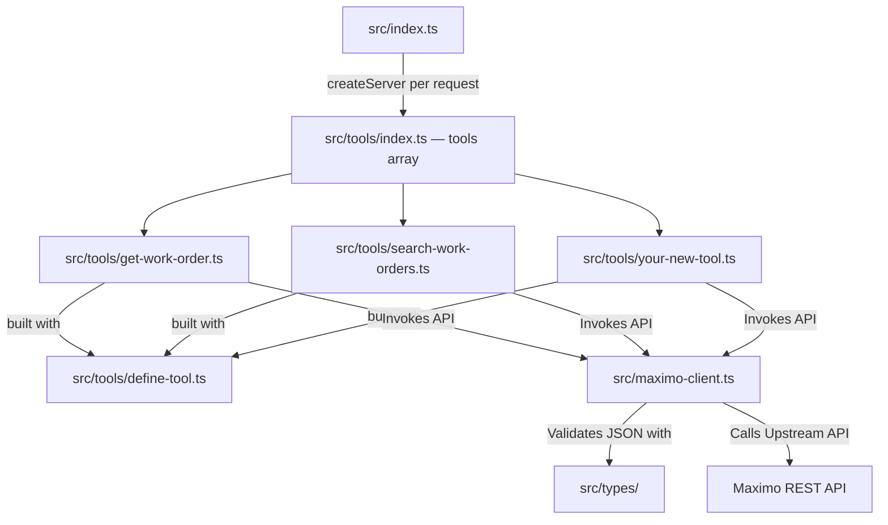

# Guide to Adding New Tools to Maximo MCP Server

This guide describes the registry-based architecture of the Maximo MCP Server and the step-by-step workflow for adding new tools.

---

## 🏗️ Architectural Overview



### Key Files
1. **[src/index.ts](../src/index.ts)**: Creates a fresh `McpServer` per HTTP request (stateless Streamable HTTP) or one for stdio, and registers all tools.
2. **[src/oauth-proxy.ts](../src/oauth-proxy.ts)**: OAuth discovery + Entra ID proxy endpoints (only when `AUTH_PROVIDER=entra-id`). You do not touch this when adding tools.
3. **[src/tools/define-tool.ts](../src/tools/define-tool.ts)**: `defineTool({...})` helper. It formats the result as JSON text, catches errors into `isError: true` results, and sets `readOnlyHint: true` by default.
4. **[src/tools/index.ts](../src/tools/index.ts)**: The `tools` array — the single list of tools the server exposes. The startup log prints the tool names from this array automatically.
5. **[src/maximo-client.ts](../src/maximo-client.ts)**: The Maximo REST client. `query(objectStructure, { where, select, orderBy, limit, pageno }, schema)` runs an OSLC query and validates the response; `q()` / `like()` quote user values safely.
6. **[src/types/](../src/types/)**: Zod input schemas (shared by tool + client) and response schemas.

---

## 🔄 Step-by-Step: Adding a New Tool

Example: a read-only tool `search_assets` on the `mxasset` object structure.

### Step 1: Locate the API resource
Use the [Maximo REST API documentation](https://ibm-maximo-dev.github.io/maximo-restapi-documentation/) or the [quick start reference](https://maximomastery.com/blog/2026/02/maximo-nextgen-rest-api-a-practical-guide-to-querying-creating-and-integrating/) to identify the object structure, the fields to select and the filters you need.

### Step 2: Define Zod schemas — `src/types/asset.ts`
```typescript
import { z } from "zod";

/** Input shape: used as the tool's inputSchema AND the client method's param type. */
export const SearchAssetsInputSchema = {
  assetnum: z.string().optional().describe("Asset number (partial match). Example: 'P-1001'"),
  location: z.string().optional().describe("Equipment tag / location (partial match)"),
  limit: z.number().int().min(1).max(100).default(10).describe("Maximum number of records to return"),
  pageno: z.number().int().min(1).optional().describe("Page number to retrieve (default 1)"),
};
export type SearchAssetsInput = z.infer<z.ZodObject<typeof SearchAssetsInputSchema>>;

export const AssetCollectionSchema = z.object({
  member: z.array(z.object({
    assetnum: z.string().optional(),
    description: z.string().optional(),
    location: z.string().optional(),
    status: z.string().optional(),
  }).passthrough()),
  responseInfo: z.any().optional(),
});
export type AssetCollection = z.infer<typeof AssetCollectionSchema>;
```
Then re-export the schemas and types from [src/types/index.ts](../src/types/index.ts).

### Step 3: Add a client method — `src/maximo-client.ts`
Use the shared `query()` helper. **Always wrap user-supplied values with `q()` (exact) or `like()` (contains)** — never interpolate them directly into `oslc.where`.

```typescript
async searchAssets(input: SearchAssetsInput): Promise<AssetCollection> {
  const { assetnum, location, limit = 10, pageno } = input;
  return this.query("mxasset", {
    where: [
      assetnum && `assetnum=${like(assetnum)}`,
      location && `location=${like(location)}`,
    ],                       // falsy entries are skipped, the rest joined with " and "
    select: "assetnum,description,location,status",
    orderBy: "+assetnum",
    limit,
    pageno,
  }, AssetCollectionSchema);
},
```

### Step 4: Define the tool — `src/tools/search-assets.ts`
```typescript
import { maximoClient } from "../maximo-client.js";
import { SearchAssetsInputSchema } from "../types/index.js";
import { defineTool } from "./define-tool.js";

export const searchAssets = defineTool({
  name: "search_assets",
  description:
    "Search Maximo Assets by asset number or location tag (partial match). " +
    "Pagination: call again with pageno to fetch another page.",
  inputSchema: SearchAssetsInputSchema,
  errorLabel: "Error searching assets",
  run: (args) => maximoClient.searchAssets(args),
});
```
`run` just returns data — no `try/catch`, no `JSON.stringify`, no `content` array. Return a reshaped object if the raw response needs unwrapping (see [get-work-order.ts](../src/tools/get-work-order.ts)). `errorLabel` can also be a function of the args, e.g. `({ ponum }) => \`Error fetching purchase order ${ponum}\``.

### Step 5: Register it — `src/tools/index.ts`
```typescript
import { searchAssets } from "./search-assets.js";

export const tools: Tool[] = [
  // ...existing tools
  searchAssets,
];
```

### Step 6: Validate
```powershell
npm run build
```
Then start the server and confirm the new tool appears in the `[registry]` startup log line and in `tools/list`.

---

## ✍️ Tools That Write to Maximo

`defineTool` marks tools `readOnlyHint: true` by default. For a tool that creates or updates records, pass explicit annotations so clients can ask the user for confirmation:

```typescript
export const updateWorkOrderStatus = defineTool({
  name: "update_work_order_status",
  description: "Change the status of a specific Maximo Work Order.",
  inputSchema: UpdateWorkOrderStatusInputSchema,
  annotations: { readOnlyHint: false, destructiveHint: false, idempotentHint: true },
  errorLabel: ({ wonum }) => `Failed to update status for work order ${wonum}`,
  run: (args) => maximoClient.updateWorkOrderStatus(args),
});
```
`fetchMaximo` only performs GET requests today, so a write tool needs its own client method that sends `POST` with the `x-method-override: PATCH` header and the `apikey` header, per the Maximo REST documentation.

---

## ⚡ Pro Tips for High-Quality Tools

* **Rich schema descriptions**: `.describe()` text is sent to the LLM. Clear descriptions and examples dramatically improve tool selection in Claude and ChatGPT.
* **Keep `oslc.select` lean**: select only the fields you need to keep payloads small and fast.
* **Safe queries**: every user value in `where` goes through `q()` or `like()`.
* **Don't re-implement error handling**: let `run` throw; `defineTool` converts it into an `isError: true` result.
* **Watch the tool count**: as the list grows past ~25–30 tools, prefer merging similar search/get tools or richer filters over adding near-duplicates, so the model can still pick the right tool.
