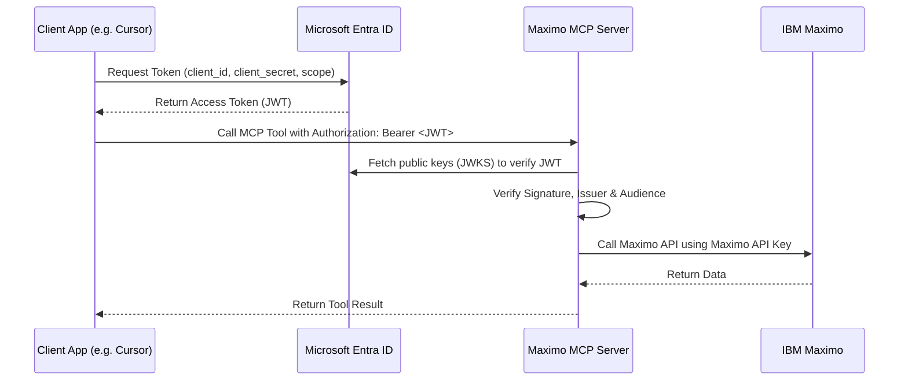

# Azure Entra ID App Registration Guide

This guide details the step-by-step process of registering applications in Microsoft Entra ID (formerly Azure Active Directory) to secure the Maximo MCP Server.

Secure communication is achieved using OAuth 2.0. The MCP Server acts as the **Resource Server (API)** that validates incoming JSON Web Tokens (JWTs), and client applications (e.g. Claude, ChatGPT, Cursor, scripts) act as **Clients** that fetch tokens from Microsoft Entra ID.

---

## Architecture Overview



To implement this, you will perform the following steps:

1. **Register the Server App (API)** in your tenant.
2. **Register the Client App** that will request tokens.
3. **Expose an API Scope** on the Server App and grant permission to the Client App.
4. **Obtain key variables** (`AZURE_TENANT_ID`, `AZURE_CLIENT_ID`, and client credentials).
5. **Configure your MCP Server environment**.

---

## Step 1: Register the Server Application (API)

The Server Application represents the Maximo MCP Server itself. It defines the audience and the permissions (scopes) required to access the API.

1. Sign in to the [Azure Portal](https://portal.azure.com).
2. If you have access to multiple tenants, use the **Directories + subscriptions** filter in the top menu to select the tenant in which you want to register the application.
3. Search for and select **Microsoft Entra ID**.
4. In the left navigation pane, select **App registrations** > **New registration**.
5. Configure the registration details:
   - **Name**: Enter a display name, such as `Maximo MCP Server`.
   - **Supported account types**: Select **Accounts in this organizational directory only (Single tenant)**.
   - **Redirect URI**: Leave this blank.
6. Click **Register** at the bottom of the page.
7. Upon successful registration, the portal will display the **Overview** pane. Copy the following values:
   - **Application (client) ID** (This is your server `AZURE_CLIENT_ID`)
   - **Directory (tenant) ID** (This is your `AZURE_TENANT_ID`)

---

## Step 2: Expose the API and Define Scopes

Now, configure the Server App registration to act as a secure API by setting its Application ID URI and defining an access scope.

1. In the Server App registration, select **Expose an API** from the left navigation pane.
2. Next to **Application ID URI**, click **Set**.
   - By default, it will suggest `api://<client-id>`. Keep this value or customize it if necessary.
   - Click **Save**.
3. Click **Add a scope** to create a custom access scope:
   - **Scope name**: `mcp.access`
   - **Who can consent?**: **Admins and users**
   - **Admin consent display name**: `Access Maximo MCP Server`
   - **Admin consent description**: `Allows the application to perform read and write operations via the Maximo MCP Server.`
   - **User consent display name**: `Access Maximo MCP Server`
   - **User consent description**: `Allows the application to perform read and write operations via the Maximo MCP Server.`
   - **State**: **Enabled**
4. Click **Add scope**.
5. Note the full scope path. It will look like: `api://<AZURE_CLIENT_ID>/mcp.access`.

---

## Step 3: Register the Client Application

The Client Application represents the application calling the MCP Server (for example: Cursor IDE, Claude Desktop, or a backend service/script).

1. Go back to **Microsoft Entra ID** > **App registrations** and click **New registration**.
2. Configure the registration details:
   - **Name**: Enter a display name, such as `Maximo MCP Client`.
   - **Supported account types**: Select **Accounts in this organizational directory only (Single tenant)**.
   - **Redirect URI**: Leave this blank.
3. Click **Register**.
4. In the client application's **Overview** pane, copy the **Application (client) ID** for the client application.

---

## Step 4: Create a Client Secret (Client Key)

To authenticate programmatically without user interaction, the client application needs a secret key.

1. In the Client App registration, select **Certificates & secrets** from the left navigation pane.
2. Select the **Client secrets** tab, then click **New client secret**.
3. Configure the secret details:
   - **Description**: e.g., `MCP Server Access Key`
   - **Expires**: Choose a suitable duration (e.g., 180 days / 6 months or custom).
4. Click **Add**.
5. > [!IMPORTANT]
   > **Copy the Secret Value immediately**. Once you navigate away from this screen or refresh the page, the secret value will be permanently masked. You will not be able to retrieve it again. (Copy the **Value** column, NOT the _Secret ID_ column).

---

## Step 5: Grant API Permissions (Consent) to the Client App

Authorize the Client App to request the scope defined on the Server App.

1. In the Client App registration, select **API permissions** from the left navigation pane.
2. Click **Add a permission**.
3. Select the **APIs my organization uses** tab.
4. Search for your server application name (`Maximo MCP Server`) and select it.
5. Choose **Application permissions** or **Delegated permissions** depending on your client scenario:
   - Select **Application permissions** if the client runs in a daemon/automated background mode (e.g., Cursor client-credentials, server-to-server integration).
   - Check the box for `mcp.access`.
6. Click **Add permissions**.
7. > [!IMPORTANT]
   > Under the **Configured permissions** table, click **Grant admin consent for <Tenant Name>** and click **Yes** to confirm. This ensures that client applications can request tokens silently without an interactive prompt.

---

## Step 6: Configure the MCP Server Environment Variables

Now that you have all the IDs and secrets, configure the MCP Server to validate these tokens. Open your `.env` file on the server and update the configuration:

```env
# Enable MS Entra ID verification
AUTH_PROVIDER=entra-id

# Directory (tenant) ID copied from Step 1
AZURE_TENANT_ID=your-azure-tenant-id-here

# Application (client) ID of the Server App copied from Step 1
AZURE_CLIENT_ID=your-server-application-client-id-here

# Audience: The expected 'aud' claim. Must match the Server App's Application ID URI set in Step 2.
# If not defined, it defaults to api://<AZURE_CLIENT_ID>
AZURE_AUDIENCE=api://your-server-application-client-id-here

# DCR Proxy Client — Application (client) ID and Secret of the Client App Registration (Step 3 & 4)
# These allow the server to handle OAuth flows automatically on behalf of MCP clients.
AZURE_PROXY_CLIENT_ID=your-client-application-client-id-here
AZURE_PROXY_CLIENT_SECRET=your-client-application-secret-value-here

# Public URL of this MCP server (required for OAuth metadata discovery)
MCP_SERVER_BASE_URL=https://your-mcp-server-domain.com
```

---

## Step 6a: Enable Dynamic Client Registration (DCR)

With the proxy client variables set, your MCP server supports **RFC 7591 Dynamic Client Registration**. This means MCP clients (Claude, ChatGPT, Cursor, etc.) can connect **without the user ever manually entering a `client_id` or `client_secret`**.

### How it works

```
User pastes server URL → MCP client auto-discovers OAuth metadata
  → MCP client self-registers via POST /register (gets a temporary client_id)
  → Server redirects /authorize → Entra ID (using the real proxy client_id)
  → User signs in with their Entra ID account (browser popup)
  → Server injects proxy credentials into POST /token → Entra ID
  → Access token returned → MCP client connected
```

The user experience is: **paste URL → sign in → done.**

### Prerequisite: Register redirect URIs for the Proxy Client

Because all MCP clients share the underlying proxy client app registration, you must pre-register the redirect URIs of each MCP client type in Azure:

1. Navigate to **Azure Portal** → **Microsoft Entra ID** → **App registrations**.
2. Select your **Client App Registration** (Step 3 — `Maximo MCP Client`).
3. Click **Authentication** → **Add a platform** → **Web**.
4. Add the redirect URI(s) for the MCP clients you want to support:

| MCP Client | Redirect URI |
| :--- | :--- |
| Claude Desktop / claude.ai | `https://claude.ai/api/mcp/auth_callback` |
| ChatGPT | `https://chatgpt.com/connector_platform_oauth_redirect` or the per-connector URL ChatGPT shows (see ChatGPT section) |
| Teams / M365 Copilot (Agents Toolkit `dcr/register`) | `https://teams.microsoft.com/api/platform/v1.0/oAuthRedirect` (if sign-in fails with `AADSTS50011`, register the exact `redirect_uri` from the error) |
| Cursor | (check Cursor documentation) |

> [!NOTE]
> Teams / M365 Copilot registers as a **confidential** client: `/register` issues it a `client_secret` (stored as a hash in `DCR_STORE_PATH`) and `/token` checks that secret before proxying. Claude and ChatGPT register with `token_endpoint_auth_method: "none"` (public client + PKCE) and get no secret.

5. Click **Save**.

> [!NOTE]
> This is a one-time admin task per MCP client type — not per user. Once a redirect URI is registered, any user in your Entra ID tenant can connect that MCP client to the server.

---


## Step 7: How to Obtain and Test Access Tokens

To verify that your configuration works, you can request an access token from Microsoft Entra ID and use it to call the server.

### 1. Request an Access Token via Bash/curl

Run the following command, replacing the placeholder values with your client details:

```bash
curl -X POST https://login.microsoftonline.com/<AZURE_TENANT_ID>/oauth2/v2.0/token \
  -H "Content-Type: application/x-www-form-urlencoded" \
  -d "grant_type=client_credentials" \
  -d "client_id=<CLIENT_APPLICATION_CLIENT_ID>" \
  -d "client_secret=<CLIENT_APPLICATION_CLIENT_SECRET>" \
  -d "scope=api://<SERVER_APPLICATION_CLIENT_ID>/.default"
```

**Response Example:**

```json
{
  "token_type": "Bearer",
  "expires_in": 3599,
  "ext_expires_in": 3599,
  "access_token": "eyJ0eXAiOiJKV..."
}
```

### 2. Request an Access Token via PowerShell

If you are on Windows, you can fetch the token using PowerShell:

```powershell
$tenantId = "<AZURE_TENANT_ID>"
$clientId = "<CLIENT_APPLICATION_CLIENT_ID>"
$clientSecret = "<CLIENT_APPLICATION_CLIENT_SECRET>"
$scope = "api://<SERVER_APPLICATION_CLIENT_ID>/.default"

$body = @{
    grant_type    = "client_credentials"
    client_id     = $clientId
    client_secret = $clientSecret
    scope         = $scope
}

$response = Invoke-RestMethod -Uri "https://login.microsoftonline.com/$tenantId/oauth2/v2.0/token" -Method Post -Body $body -ContentType "application/x-www-form-urlencoded"
$response.access_token
```

### 3. Verify Token with the MCP Server

Once you have the `access_token` string, send an authenticated request to the Maximo MCP Server's `/mcp` endpoint:

```bash
curl -i -X POST https://your-mcp-server-domain.com/mcp \
  -H "Authorization: Bearer <access_token>" \
  -H "Content-Type: application/json" \
  -d '{"jsonrpc": "2.0", "method": "tools/list", "id": 1}'
```

The server should respond with `200 OK` and return the list of tools.

---

## Integrating with ChatGPT (Custom MCP Connector)

ChatGPT can connect to remote MCP servers as a **custom connector** (Developer mode). It uses the same OAuth flow as Claude: it reads the server's OAuth metadata, self-registers via `POST /register` (DCR), then sends the user to Entra ID through `/authorize`. No Client ID or secret has to be typed in.

> [!NOTE]
> Like Claude, ChatGPT connects from **OpenAI's cloud**, so the MCP server must be reachable from the public internet. Custom connectors require a plan that allows Developer mode, and on Business/Enterprise workspaces an admin may need to enable it.

### Step 1: Register the ChatGPT Redirect URI in Azure

1. In ChatGPT, start creating the connector (Step 2 below) and copy the **callback / redirect URL** ChatGPT shows. Depending on the ChatGPT version it is either
   - `https://chatgpt.com/connector_platform_oauth_redirect` (fixed, older connectors), or
   - `https://chatgpt.com/connector/oauth/<callback-id>` (per connector).
2. Go to **Azure Portal** → **Microsoft Entra ID** → **App registrations** → your **Client App Registration** (`Maximo MCP Client`, Step 3).
3. **Authentication** → **Add a platform** (or **Add URI** if Web already exists) → **Web**.
4. Paste the exact URL from ChatGPT. Registering `https://chatgpt.com/connector_platform_oauth_redirect` as well does no harm.
5. Click **Save**.

> [!IMPORTANT]
> Entra ID compares redirect URIs exactly. If sign-in fails with `AADSTS50011` (redirect URI mismatch), copy the `redirect_uri` from the error page and add it here.

### Step 2: Add the Connector in ChatGPT

1. Open [chatgpt.com](https://chatgpt.com) → **Settings** → **Apps & Connectors** → **Advanced settings** → enable **Developer mode**.
2. Back in **Apps & Connectors**, click **Create** (in newer ChatGPT versions: **Plugins** → **+** → **Add custom MCP server**).
3. Fill in:

| Field | Value |
| :--- | :--- |
| **Name** | `Maximo` |
| **Description** | e.g. `Work Orders, Purchase Orders, Vendors, Budget & Exchange Rates from Maximo` |
| **MCP Server URL** | `https://your-mcp-server-domain.com/mcp` |
| **Authentication** | **OAuth** (leave Client ID / Secret empty — the server supports DCR) |

4. Tick **I trust this application** and click **Create**.
5. ChatGPT opens the Microsoft sign-in page; sign in with your Entra ID account.
6. In a chat, enable the connector from the **+** menu (Developer mode / connectors) and ask e.g. *"Find open work orders for tag HT-PM-4415C"*.

### Troubleshooting

| Symptom | Cause / Fix |
| :--- | :--- |
| ChatGPT says it cannot find OAuth metadata | Check `MCP_SERVER_BASE_URL` and that `https://<domain>/.well-known/oauth-authorization-server/mcp` returns 200 |
| `invalid_client` / "Unknown client_id" | ChatGPT reused a registration from before a server reset — delete and re-create the connector so it registers again |
| `AADSTS50011` redirect URI mismatch | Add the exact redirect URI from the error to the Client App Registration (Step 1) |
| Connected but tools fail with 401 | Token audience mismatch — check `AZURE_AUDIENCE` equals the Server App's Application ID URI |

---

## Integrating with Claude Desktop (Custom Connectors)

Claude Desktop supports connecting to remote MCP servers via **Custom Connectors**. The Maximo MCP Server exposes [RFC 9728 Protected Resource Metadata](https://datatracker.ietf.org/doc/html/rfc9728) so Claude can auto-discover the Entra ID authorization server.

> [!NOTE]
> When you add a Custom Connector in Claude Desktop, the connection originates from **Anthropic's cloud infrastructure**, not from your local machine. Your MCP server must be reachable over the public internet from Anthropic's IP ranges.

### Option A: OAuth 2.0 Authentication (Recommended)

This method uses the full MCP Authorization flow (OAuth 2.1 + PKCE) via Entra ID.

**Prerequisites & Azure Setup:**
- `AUTH_PROVIDER=entra-id` configured on the MCP server
- `MCP_SERVER_BASE_URL` set to the public URL of the MCP server (e.g., `https://mcp-server1.biendongpoc.vn`)
- In Azure Portal > **Microsoft Entra ID** > **App registrations** > select your **Client App Registration** (`8f65db11-fbe5-41e4-b5c3-36387245e73e`):
  1. Go to **Authentication** from the left menu.
  2. Under **Platform configurations**, click **Add a platform** (or **Add URI** if Web is already added).
  3. Select **Web**.
  4. Add the exact Redirect URI: `https://claude.ai/api/mcp/auth_callback`
  5. Click **Save**.

**Steps in Claude Desktop / claude.ai:**

1. Open **Claude Desktop** or [claude.ai](https://claude.ai).
2. Navigate to **Settings** > **Connectors** (or **Customize** > **Connectors** for Pro/Max users).
3. Click **+** then **Add custom connector**.
4. Enter your MCP server URL: `https://your-mcp-server-domain.com/mcp`
5. Click **Advanced settings** and fill in:

| Field | Value | Source |
| :--- | :--- | :--- |
| **OAuth Client ID** | The **Application (client) ID** of your **Client App Registration** | Step 3 |
| **OAuth Client Secret** | The **Client Secret Value** of your **Client App Registration** | Step 4 |

6. Click **Add** to finish.
7. Claude will initiate the OAuth flow and open browser to Microsoft Entra ID.
8. Once authenticated, enable the connector in your chat via the **+** button > **Connectors**.

> [!IMPORTANT]
> If Claude prompts for a redirect URL, copy it and register it in your Client App Registration under **Authentication** > **Add a platform** > **Web** (same as Step 1 in the ChatGPT section above).

### Option B: Static API Key Authentication

If you prefer a simpler setup without OAuth, you can use a static Bearer token.

**Prerequisites:**
- `AUTH_PROVIDER=static` configured on the MCP server
- `MCP_API_KEY` set to a secure token

**Steps:**

1. Follow steps 1-4 from Option A above to add the connector URL.
2. Click **Advanced settings**.
3. Enter your `MCP_API_KEY` value as the static Bearer token.
4. Click **Add**.

> [!NOTE]
> Static token auth uses Claude's `static_headers` (Beta) feature. This is simpler but does not provide per-user authentication.

---

## Using stdio Transport for Local MCP Clients

For local development or when running MCP clients that support **stdio transport** (Claude Desktop local config, Cursor, Gemini CLI, Windsurf, etc.), you can run the MCP server as a local subprocess. In this mode, no HTTP server or authentication is needed — the host OS handles security.

### Configuration

Set the `TRANSPORT` environment variable:

```env
TRANSPORT=stdio
```

Or pass it inline:

```bash
TRANSPORT=stdio npx tsx src/index.ts
```

### Claude Desktop (Local stdio)

Add the following to your `claude_desktop_config.json`:

```json
{
  "mcpServers": {
    "maximo": {
      "command": "npx",
      "args": ["tsx", "src/index.ts"],
      "cwd": "/path/to/mcp-maximo-080526",
      "env": {
        "TRANSPORT": "stdio",
        "API_KEY": "your-maximo-api-key",
        "MAXIMO_URL": "https://your-maximo-url.com"
      }
    }
  }
}
```

### Cursor / Gemini CLI

Most local MCP clients follow a similar pattern: specify the command, args, and environment variables in their MCP server configuration.

> [!NOTE]
> In stdio mode, the MCP server communicates via stdin/stdout. All log messages are written to stderr so they don't interfere with the MCP protocol.
